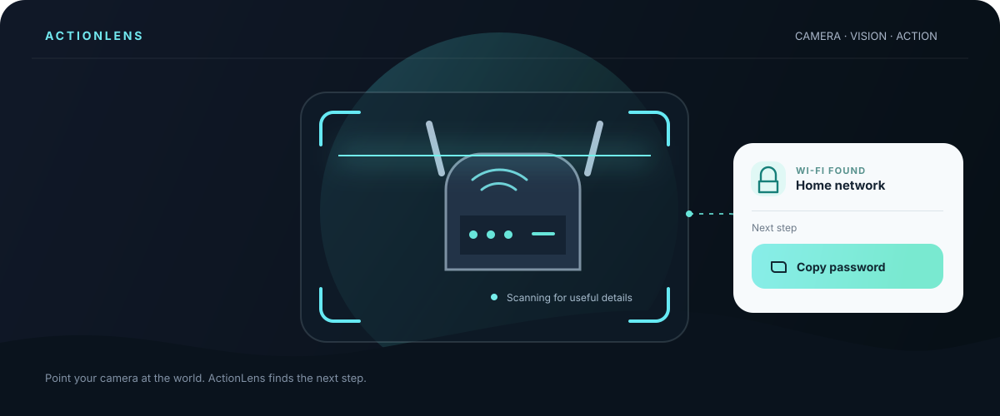
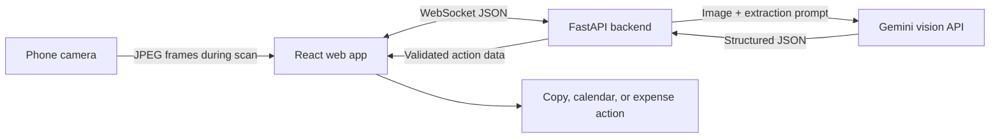

<div align="center">

# ActionLens

### See it. Do it.

**Turn the things around you into useful next steps.** ActionLens uses your camera and a vision-language model to recognize actionable details in the real world, then puts the relevant action one tap away.



*Point. Scan. Act.*

</div>

## The idea

Useful information is everywhere, but often trapped in the physical world: a Wi-Fi password printed on a router, an event date on a flyer, a total on a receipt, or an email on a business card. ActionLens lets people point their phone at an item and turn what they see into an action—without manually retyping it or navigating through forms.

Tap **Scan now** to start an 8-second scan. ActionLens captures up to four compressed frames, sends one inference request at a time, and presents a contextual action when it recognizes something useful.

| What it sees | What you can do |
| --- | --- |
| Wi-Fi details | Copy the password |
| Event flyer | Download a calendar file |
| Contact card | Copy an email or phone number |
| Receipt | Log the total as an expense |
| Tracking label | Copy the tracking number |

## How it works



The frontend handles camera access, scan timing, and action UI. The backend validates incoming frames and serializes model calls. Gemini performs hosted image inference, so the backend does not download model weights or require a GPU.

## Built with

- **Frontend:** React, Vite, Tailwind CSS, browser MediaDevices API, native WebSockets
- **Backend:** Python 3.10+, FastAPI, Pydantic v2
- **Vision:** Google Gemini API with structured JSON output
- **Hosting:** Netlify-ready frontend; container-ready backend

## Run locally

### Prerequisites

- Python 3.10 or newer
- Node.js 18 or newer and npm
- A Gemini API key from [Google AI Studio](https://aistudio.google.com/app/apikey)

### 1. Start the backend

From the repository root, create and activate a virtual environment, then install the backend dependencies:

```bash
cd backend
python -m venv .venv
```

Activate it using the command for your shell:

```bash
# macOS / Linux
source .venv/bin/activate

# Windows PowerShell
.venv\Scripts\Activate.ps1
```

Install packages and configure the API key in the backend process environment:

```bash
python -m pip install -r requirements.txt
```

```bash
# macOS / Linux
export GEMINI_API_KEY="your_gemini_api_key"
export CORS_ORIGINS="http://localhost:5173"

# Windows PowerShell
$env:GEMINI_API_KEY = "your_gemini_api_key"
$env:CORS_ORIGINS = "http://localhost:5173"
```

Run the service from the `backend` directory:

```bash
uvicorn main:app --host 0.0.0.0 --port 8000 --reload
```

The health endpoint is available at `http://localhost:8000/health`.

### 2. Start the frontend

In a second terminal, from the repository root:

```bash
cd frontend
npm install
npm run dev
```

Open the Vite URL, grant camera permission, and tap **Scan now**. Camera access requires HTTPS on deployed sites; localhost is allowed for development.

## Configuration

| Variable | Where | Purpose | Default |
| --- | --- | --- | --- |
| `GEMINI_API_KEY` | Backend | Authenticates Gemini API requests | Required |
| `GEMINI_MODEL` | Backend | Gemini model name | `gemini-3.5-flash-lite` |
| `CORS_ORIGINS` | Backend | Comma-separated allowed frontend origins | `http://localhost:5173` |
| `VITE_WS_URL` | Frontend build | Backend WebSocket endpoint | `ws(s)://<current-host>:8000/ws/stream` |

For a hosted frontend, set `VITE_WS_URL` to the backend's secure WebSocket URL, for example `wss://api.example.com/ws/stream`, before building. Set `CORS_ORIGINS` to the deployed frontend origin, such as `https://example.netlify.app`.

The root `netlify.toml` configures the frontend build. The backend includes a Dockerfile and can run on a Python web-service host. For example, a Render service can use `backend` as its root directory, `pip install -r requirements.txt` as its build command, and `uvicorn main:app --host 0.0.0.0 --port $PORT` as its start command. Free hosting plans may sleep while idle and have usage limits.

## WebSocket contract

The client sends one image at a time to `/ws/stream`:

```json
{"image":"data:image/jpeg;base64,<encoded-image>"}
```

The backend replies with normalized extraction data:

```json
{
  "detected": true,
  "category": "CONTACT",
  "data": {
    "title": "Example Person",
    "value": "+1 555 010 1234",
    "date": "",
    "email": "person@example.com"
  },
  "bounding_box": [0.1, 0.2, 0.8, 0.7]
}
```

`category` is one of `WIFI`, `EVENT`, `CONTACT`, `TRACKING`, `RECEIPT`, or `NONE`. The `data` object always includes `title`, `value`, `date`, and `email`; unused fields are empty strings. `bounding_box` contains normalized `[x1, y1, x2, y2]` coordinates between 0 and 1.

## Privacy and API usage

Camera frames are sent to the configured backend only after a person starts a scan. The backend forwards them to Gemini for inference. API quotas and pricing depend on the selected model and account. Review [Google's Gemini API pricing and data-use terms](https://ai.google.dev/gemini-api/docs/pricing) before using real personal or sensitive information; free-tier content may be used to improve Google's products. Never expose `GEMINI_API_KEY` in frontend code or commit it to the repository.

## Project layout

```text
ActionLens/
├── backend/
│   ├── main.py          # FastAPI health endpoint and WebSocket route
│   ├── vlm_engine.py    # Gemini image inference and response validation
│   ├── requirements.txt
│   └── Dockerfile
├── frontend/
│   ├── src/App.jsx      # Camera scanning and contextual actions
│   └── package.json
├── docs/
│   └── actionlens-hero.svg
└── netlify.toml
```
